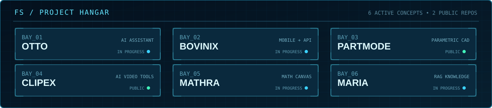
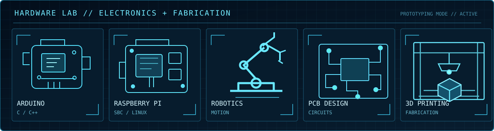
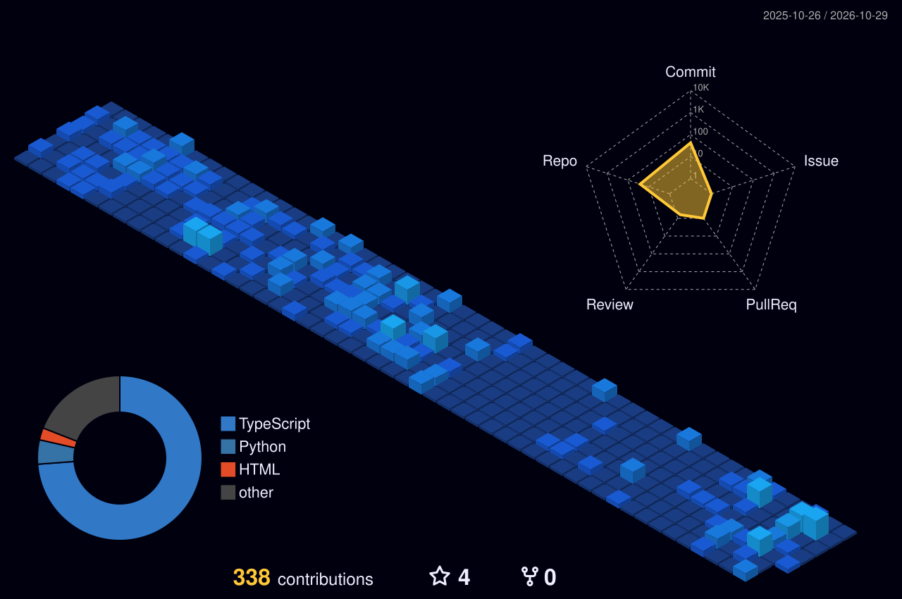

<!-- FELIPE SALVIANO // FS SYSTEMS — GitHub profile -->
<div align="center">





<a href="https://www.instagram.com/salviandev/"></a>
<a href="https://www.linkedin.com/in/felipe-salviano-a9821723b/"></a>

<br />


</div>

## `> whoami --identity`

I'm **Felipe Salviano** — a full-stack developer, maker and Software Engineering student who enjoys turning ideas into working systems, connecting **software, AI, robotics, electronics and automation**.

I started coding in **2017, at age 15**. I graduated as a **Mechatronics Technician at IFPR in 2020** and have been studying **Software Engineering at UniCesumar since 2023** *(degree in progress)*.

Outside my studies, I build **personal projects, prototypes and experiments**: web and mobile applications, intelligent assistants, electronics, Arduino/Raspberry Pi projects, robotics, PCB design and 3D printing. I'm currently expanding my knowledge of **artificial intelligence and embedded systems**.

```ts
interface EngineerProfile {
  developer: "Felipe Salviano";
  codingSince: 2017;
  mainStack: ["TypeScript", "Next.js", "Node.js", "Express", "PostgreSQL", "Python"];
  makerLab: ["Arduino", "Raspberry Pi", "Robotics", "PCB Design", "3D Printing"];
  currentlyStudying: ["Artificial Intelligence", "Embedded Systems"];
  motto: "Build what doesn't exist yet.";
}
```

## `> load_modules --core_stack`

<div align="center">

<a href="https://skillicons.dev"></a>

**Main stack** — TypeScript · Next.js · Node.js · Express · PostgreSQL · Python

<a href="https://skillicons.dev"></a>

<sub>Additional tools include React, Tailwind CSS, Prisma, MySQL, Docker, Git and more.</sub>

</div>

## `> project_hangar --open_bays`

<div align="center">



</div>

<table>
<tr>
<td width="50%" valign="top">
<h3>01 // OTTO</h3>
<p><strong>Hybrid AI assistant</strong> • Personal project</p>
<p>Voice interaction, local/remote inference, automation, tools and futuristic desktop HUD.</p>
 
</td>
<td width="50%" valign="top">
<h3>02 // BOVINIX</h3>
<p><strong>Livestock management</strong> • Personal project</p>
<p>Mobile-first livestock operations, offline workflows, connected devices and backend services.</p>
 
</td>
</tr>
<tr>
<td width="50%" valign="top">
<h3>03 // <a href="https://github.com/fesalvian/partmode">PARTMODE ↗</a></h3>
<p><strong>Parametric CAD</strong> • Public repository</p>
<p>Local-first mechanical CAD using OpenCascade WebAssembly, replicad and three.js.</p>
<a href="https://github.com/fesalvian/partmode"></a>
</td>
<td width="50%" valign="top">
<h3>04 // <a href="https://github.com/fesalvian/CLIPEX">CLIPEX ↗</a></h3>
<p><strong>AI-assisted video workflow</strong> • Public repository</p>
<p>Desktop tooling for identifying livestream highlights, reviewing clips and preparing vertical videos.</p>
<a href="https://github.com/fesalvian/CLIPEX"></a>
</td>
</tr>
<tr>
<td width="50%" valign="top">
<h3>05 // MATHRA</h3>
<p><strong>Interactive math workspace</strong> • Personal project</p>
<p>Infinite canvas and mathematical learning tools, exploring AI-assisted practice and visualization.</p>

</td>
<td width="50%" valign="top">
<h3>06 // MARIA</h3>
<p><strong>Institutional AI knowledge assistant</strong> • Personal project</p>
<p>Retrieval-augmented generation (RAG) and scoped access to operational knowledge.</p>

</td>
</tr>
</table>

<sub>Selected projects are works in progress or evolving prototypes. Public repository links appear only where available.</sub>

## `> hardware_lab --prototype_mode`

<div align="center">




</div>

My maker projects explore **Arduino C/C++**, Raspberry Pi, electronics, robotic mechanisms, board layouts and 3D printed parts. I'm learning more about **embedded systems** and AI to better connect physical devices with intelligent software.

The illustrations above are technical concept art — not photographs of completed builds.

## `> ai_toolchain --active`

I use **Claude Code, OpenAI Codex and Claude Design** for assisted programming, interface prototyping, architecture exploration and development workflows — always reviewing the resulting implementation.

<div align="center">


</div>

## `> telemetry --github_3d`

<div align="center">



<sub>Generated from actual GitHub activity using <a href="https://github.com/yoshi389111/github-profile-3d-contrib">GitHub Profile 3D Contrib</a>. Updates automatically through GitHub Actions after initial activation.</sub>

<br />


</div>

<sub>GitHub language distribution measures repository composition, not proficiency. Third-party stats cards may be temporarily unavailable; the 3D calendar is stored in this repository.</sub>

## `> establish_connection --priority_instagram`

<div align="center">

### Follow the builds, prototypes and developer experiments

<a href="https://www.instagram.com/salviandev/"></a>

<a href="mailto:felipesalviano00@hotmail.com"></a>
<a href="https://www.linkedin.com/in/felipe-salviano-a9821723b/"></a>

<br />

**`SYSTEM STATUS: ONLINE`** · **`MODE: CONTINUOUS IMPROVEMENT`**


</div>
